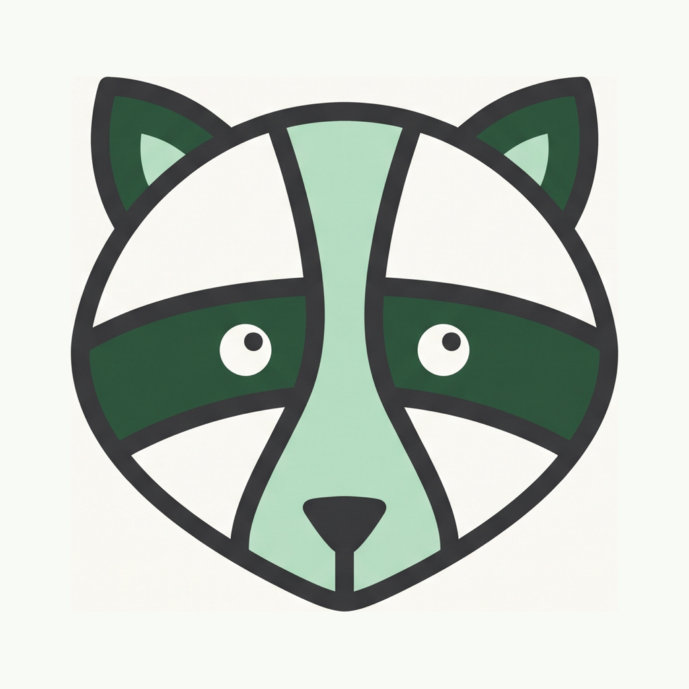

# LaVioLab Atlas



LaVioLab Atlas helps you get a side project found. It routes a live site through search, AI search,
content and analytics, and every result links to the page of the [Pet Project Atlas](https://atlas.smolevich.com)
that explains why it matters. It is made by Stanislav Shupilkin at LaVioLab and is free and open source
under the MIT licence.

## Install

```text
/plugin install laviolab-atlas --marketplace Smolevich/pet-project-atlas
```

In Codex:

```text
codex plugin marketplace add Smolevich/pet-project-atlas
codex plugin add laviolab-atlas@pet-project-atlas
```

## Commands

| Command | What it does |
|---|---|
| `/laviolab-atlas:start` | Asks for your site URL and audience language, runs the third-party `seo-audit` and `geo-audit` skills, merges their findings into one list ordered by what blocks what, and names three things to do this week. |
| `/laviolab-atlas:content-plan` | Turns a project description and an optional Search Console export into query clusters, one page per cluster, queued by money. |
| `/laviolab-atlas:report` | The weekly slice: six numbers from Search Console and your own product data, the delta against the previous period, three conclusions and one action. |

## What it runs and where it connects

The plugin contains only instructions (skills). It ships no scripts, no binaries, no MCP server and
no hooks. Everything below happens on your machine, in your Claude Code session, and only when you run
a command.

- **`start`** lists `~/.agents/skills/`, `~/.claude/skills/` and `./.claude/skills/` to see whether
  `seo-audit` and `geo-audit` are installed, and fetches the URL you give it through those audits.
  **It never installs anything.** If an audit is missing, it prints the `npx skills add -g …` line and
  stops; you decide whether to install third-party code. Those audits are maintained by other people
  (`coreyhaines31/marketingskills`, `zubair-trabzada/geo-seo-claude`) and are not part of this plugin.
- **`content-plan`** reads files you hand it, such as a query export, and may fetch public pages you
  name. It writes the plan as a markdown file in your project, so you can commit it next to the pages.
- **`report`** reads Search Console in one of two ways, and says which before it pulls anything:
  - through a browser tool you already have connected (for example Playwright MCP), using the session
    you are already logged into;
  - or through the Google REST APIs. On this route it uses **your own local Google credentials**: it
    runs `gcloud auth application-default print-access-token` to read an access token from your gcloud
    login and sends it, with `curl`, only to `searchconsole.googleapis.com` and, if you use GA4,
    `analyticsdata.googleapis.com`. The token is used for those calls and is not stored or sent
    anywhere else. If you have not logged in, it tells you which `gcloud` command to run and stops.

## Data and privacy

LaVioLab Atlas collects nothing. It has no server, no telemetry and no analytics; nothing you run
through it is sent to LaVioLab or to the author. The only network traffic is what is listed above: the
sites you ask it to check, and Google's APIs when you choose the API route of `report`. Full note:
<https://atlas.smolevich.com/privacy/>.

## Support

Issues and questions: <https://github.com/Smolevich/pet-project-atlas/issues>.
