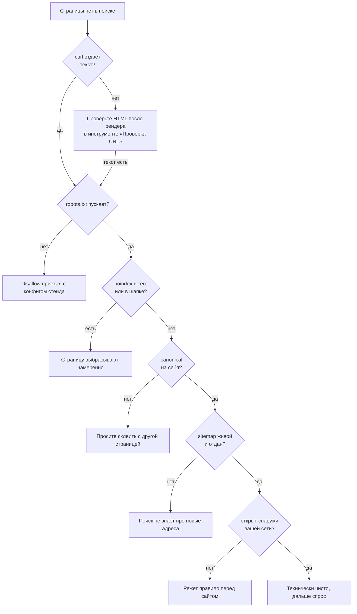

## Что решаем

Сайт в проде уже недели, а поиск по нему не отдаёт ничего. Не слабая позиция — вообще ни одного результата.

Индексация ломается сверху вниз. Сначала поисковый робот должен забрать страницу, потом обойти её, потом проиндексировать, и только после этого страница может попасть в результаты.

Переписанный `title` на странице с `noindex` не меняет ничего. Поэтому проверки ниже идут по порядку: останавливайтесь на первой, которая упала, — пока страница заблокирована, всё остальное вы всё равно не измерите.



## Шаги

### Получает ли робот хоть какой-то текст

Первым делом я смотрю, что отдаёт сервер до всякого JavaScript. Заберите страницу и найдите в ответе то предложение, которое на ней видно глазами:

```
curl -sL https://example.com/page | grep -i "фраза, которую видно на странице"
```

Если grep молчит, а в браузере текст есть, я смотрю HTML после рендера. Он появляется в Search Console в результатах проверки опубликованной страницы через «Проверку URL».

Google выполняет JavaScript. Не все краулеры так умеют. Если Google и после рендера не видит текст, откройте в результатах проверки список ресурсов и сообщения JavaScript: там видно, какой файл не загрузился и была ли ошибка, из-за которой страница не отрисовалась.

Текст можно отдать сразу. Для этого подойдёт серверный рендеринг или пререндер на сборке.

### Что на самом деле написано в вашем robots.txt

Заберите файл с боевого домена и прочитайте целиком — не по памяти и не только те строки, которые вы туда писали сами:

```
curl -s https://example.com/robots.txt
```

Чаще всего там лежит `Disallow: /`: на черновом домене эта строка стояла по делу, а в прод уехала вместе с остальным конфигом. Второй вариант тише: Google читает только первые 500 КБ файла, а сгенерированный robots.txt может молча обрезаться посередине, и всё, что ниже обрыва, для Google не существует.

### Не просите ли вы поиск выбросить страницу

`noindex` живёт в двух местах. Мета-тег лежит в HTML, и его видно в исходном коде страницы, а заголовок ответа `X-Robots-Tag` не показывается там вообще:

```
curl -sI https://example.com/page | grep -i x-robots-tag
```

`curl -sI` шлёт HEAD-запрос и печатает одни заголовки, а в браузере то же самое лежит во вкладке Network, в запросе документа, в секции Response Headers.

Заголовок ставит фреймворк, веб-сервер или CDN. Это три разных файла, и открыть придётся каждый. Есть ещё форма для конкретного агента — `X-Robots-Tag: googlebot: noindex`, — и выглядит она как обычная строка конфигурации, поэтому глаз её пропускает.

Страницу с `noindex` поиск честно забирает и разбирает. А потом намеренно выбрасывает.

### Сколько у страницы адресов и куда она показывает

Каждая страница должна указывать canonical на себя или на реальный оригинал:

```
curl -sL https://example.com/page | grep -i 'rel="canonical"'
```

Плохой шаблон ставит canonical на главную сразу на всех страницах. Это просьба к поиску: выбрось всё, кроме главной.

Дальше считаем, сколько адресов ведёт на одну и ту же страницу. Слеш в конце, `www`, `http`, `index.html`, метки трекинга — каждый даёт ещё один адрес. Все они должны редиректить на один:

```
for u in http://example.com/page https://www.example.com/page https://example.com/page/ https://example.com/page/index.html; do
  curl -o /dev/null -sw "%{http_code} %{redirect_url}\n" "$u"
done
```

Иначе сигнал делится между дублями и sitemap начинает спорить с тегом canonical. Этот спор поиск разберёт сам, без вас.

### Живой ли sitemap, а не просто лежит ли он

Проверяйте не наличие файла. Проверяйте, что каждый URL в нём отвечает 200 и что записан он полным адресом, в канонической форме:

```
curl -s https://example.com/sitemap.xml | grep -o '<loc>[^<]*' | cut -c6- |
  while read -r url; do curl -o /dev/null -sw "%{http_code} $url\n" "$url"; done
```

Протокол ограничивает один файл 50 000 URL и 50 МБ без сжатия. Дальше файл надо разбить и добавить sitemap index, а если карта набита редиректами и 404, её вообще перестают читать как источник правды о сайте.

### Видно ли сайт снаружи вашей сети

Последнюю проверку нельзя запускать со своей машины. Резолвите домен с чужого адреса и запрашивайте страницу без кук:

```
ssh other-box 'curl -sI https://example.com/page'
```

Access, защита паролем и правила для роботов в сети перед сайтом отдают форму входа или код 403. В `robots.txt` ничего этого не видно.

У правила есть имя и экран: **AI Crawler and Agent access policies** под **Security** → **Settings**, фильтр **Bot traffic**, на всех тарифах. Когда в политике стоит Block, Cloudflare отказывает подходящему агенту в своей сети, и до вашего сервера запрос не доходит.

Поэтому в журнале сервера отказа тоже нет: увидеть его можно только в **Analytics** → **Events** у Cloudflare. Весь механизм разобран здесь: [AI-роботы и llms.txt](/ru/geo/llms-txt-and-crawlers/).

Если слой перед сайтом ещё только выбирается, страница [что бесплатный Cloudflare даёт пет-проекту](/ru/indexing/cloudflare-free/) разделяет DNS, кэш, Access, Tunnel и правила для роботов по задачам, которые они решают.

## Что не сработало

- **Ждать, пока индекс догонит**. Crawler действительно возвращается, читает то же правило и уходит. Терпение не правит заголовок.
- **Отправить один URL заново в инструменте проверки**. Перезапрос идёт по тому же `robots.txt`, с тем же заголовком и тем же пустым телом. Вердикт вернётся тот же. Дневная квота потрачена.
- **Считать доказательством доступа отчёт стороннего робота**. Отчёт показывает, что чужой робот смог забрать страницу со своего адреса, а оставит ли поиск эту страницу у себя — вопрос совсем другой.
- **Проверять только со своего ноутбука**. Активный вход и локальный кэш браузера могут спрятать поломку целиком. CDN перед вашим сервером отвечает на часть запросов сам, поэтому до приложения они не доходят.
- **Править `robots.txt`, когда блок жил перед сайтом**. Защита от роботов и правила WAF в этом файле не видны, и сам файл был чистым всё это время. Искать надо **AI Crawler and Agent access policies** под **Security Settings** и соседнее пользовательское правило WAF — это самая частая скрытая блокировка, которая мне попадается.
- **Общее правило 404 на сайте с маршрутами в браузере**. На другом моём сайте `/* /404.html 404` в файле редиректов зацепил и маршруты без файла в сборке. Русская главная из sitemap отвечала 404, а браузер это прятал. Теперь каждый маршрут проходит prerender, а проверка sitemap идёт после каждого деплоя.
- **Сначала переписать `title` и описания**. На странице, которой нет в индексе, работа с текстом не даёт ничего измеримого.

## Проверить

Запустите скилл `seo-audit` из раздела [Tools](/ru/tools/): он идёт тем же порядком и собирает ответы в один отчёт, а руками то же самое занимает больше времени.

Потом проверьте руками то, что отчёт подделать не может:

- `curl -sI` на странице отдаёт 200 и не несёт `X-Robots-Tag`.
- Текст страницы есть в исходном HTML или в HTML после рендера в результатах проверки опубликованной страницы.
- URL Inspection в Search Console говорит, что URL есть в Google.
- В **Analytics** → **Events** у Cloudflare, с фильтром по действию Block, для ваших адресов пусто, потому что заблокированный робот виден там и больше нигде.

Сколько страниц вообще дошло до индекса, грубо видно прямо из поисковой строки:

```
site:example.com
```

Формулировки в Search Console читайте буквально. «Discovered — currently not indexed» значит, что URL известен и не был забран, а «Crawled — currently not indexed» — что URL забран и признан не стоящим хранения. Это два разных бага, и чинят их по-разному.

Как только в индекс попала первая страница, отдавайте остальные: [отдать и проверить](/ru/indexing/submit-and-verify/).
